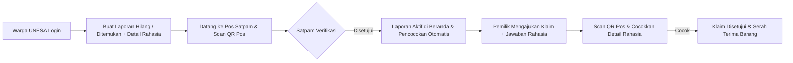

<div align="center">
  
  <h1>CampusFind — UNESA</h1>
  <p><strong>Temukan kembali barangmu di kampus.</strong></p>
  <p>Aplikasi pelaporan, pencarian, dan klaim barang hilang &amp; ditemukan untuk civitas academica Universitas Negeri Surabaya dengan verifikasi langsung oleh petugas satpam.</p>

  <p>
    
    
    
    
  </p>
</div>

---

## Tentang Aplikasi

**CampusFind** (`campusfind`) membantu mahasiswa, dosen, tenaga kependidikan, serta petugas keamanan di lingkungan **Universitas Negeri Surabaya (UNESA)** dalam menangani barang hilang dan barang temuan secara terstruktur dan aman.

Untuk mencegah penyalahgunaan maupun klaim palsu, setiap laporan dan pengajuan klaim diverifikasi di pos satpam (**Pos Gerbang Depan** atau **Pos Gerbang Belakang**) menggunakan **Detail Rahasia** barang serta **QR Barcode Pos Satpam** yang bersifat sementara dan sekali pakai.

---

## Fitur Utama

### 1. Warga UNESA (Mahasiswa, Dosen & Tendik)
- **Autentikasi Berbasis Domain Kampus**: Validasi login menggunakan email resmi UNESA (`@unesa.ac.id` atau `@mhs.unesa.ac.id`).
- **Lapor Barang Hilang & Ditemukan**: Formulir terstruktur dengan pilihan kategori (`Dompet`, `Elektronik`, `Tas`, `Kunci`, `Pakaian`, `Dokumen/Kartu`, `Alat Tulis`, `Lainnya`), unggah foto barang, area kampus, pos satpam tujuan, serta **Detail Rahasia** yang hanya dapat dilihat oleh pelapor dan satpam.
- **Pencarian & Filter Lengkap**: Cari barang berdasarkan kata kunci, rentang waktu, kategori, area kampus, pos satpam, dan jenis laporan.
- **Pencocokan Otomatis (*Smart Matching*)**: Setelah laporan disetujui, sistem menghitung skor kemiripan antara laporan *Hilang* dan *Ditemukan* berdasarkan kategori, nama barang, deskripsi & detail rahasia, lokasi area, serta kedekatan tanggal (ambang batas kecocokan `>= 50%`).
- **Klaim Barang & Scan QR Pos Satpam**: Ajukan klaim dengan menjawab ciri rahasia barang, lalu pindai QR Pos Satpam menggunakan kamera (`mobile_scanner`) atau masukkan kode manual.
- **Notifikasi dengan Suara & Getar**: Notifikasi otomatis untuk status verifikasi, kecocokan barang, dan progres klaim lengkap dengan efek suara (`assets/notif.wav`) dan *haptic feedback*.

### 2. Petugas Satpam
- **Dashboard Pos Jaga**: Pantau antrean laporan dan klaim yang menunggu verifikasi pada pos bertugas (**Pos Gerbang Depan** / **Pos Gerbang Belakang**), beserta opsi ganti pos tugas.
- **QR Barcode Pos Dinamis (Sekali Pakai)**: Tampilkan QR Pos Satpam yang berlaku selama **2 menit** dan otomatis diperbarui segera setelah 1 warga berhasil memindainya.
- **Verifikasi Detail Rahasia & Serah Terima**: Perbandingan berdampingan antara detail rahasia dari pelapor dan jawaban pengklaim, dilengkapi layar bukti serah terima barang.

### 3. Tampilan & Aksesibilitas
- **Mode Terang & Mode Gelap**: Ilustrasi kampus kustom (`CustomPaint`) yang beradaptasi antara suasana siang dan malam.
- **Skala Ukuran Font**: Pilihan ukuran teks **Kecil** (`0.9x`), **Sedang** (`1.0x`), dan **Besar** (`1.15x`).
- **Kustomisasi Profil & Tutorial Interaktif**: Ganti foto profil dari perangkat dan akses panduan penggunaan sesuai peran kapan saja.

---

## Alur Kerja Aplikasi



---

## Tech Stack & Dependensi

| Paket | Kegunaan |
| :--- | :--- |
| `flutter` (Material 3) | Framework utama antarmuka pengguna |
| `google_fonts` | Tipografi aplikasi menggunakan font **Inter** |
| `mobile_scanner` | Pemindaian QR Barcode Pos Satpam via kamera |
| `qr_flutter` | Pembuatan QR Barcode dinamis untuk Pos Satpam |
| `image_picker` | Pemilihan foto barang laporan, bukti klaim, dan avatar profil |
| `shared_preferences` | Penyimpanan lokal persisten untuk data laporan, klaim, notifikasi, dan pengaturan |
| `audioplayers` | Pemutaran efek suara notifikasi (`assets/notif.wav`) |
| `flutter_launcher_icons` | Generator ikon aplikasi Android & iOS |

---

## Struktur Proyek

```text
├── assets/
│   ├── icon_foreground.png   # Ikon foreground adaptive launcher
│   ├── logo.png              # Logo utama aplikasi CampusFind
│   └── notif.wav             # Audio efek notifikasi
├── lib/
│   ├── main.dart             # Entry point, konfigurasi tema & font scale
│   ├── core.dart             # Model data, Store (SharedPreferences), QR token & algoritma matching
│   ├── auth_screens.dart     # Splash screen, pemilihan peran, login & tutorial interaktif
│   ├── student_screens.dart  # Beranda, form laporan, pencarian, klaim, scan QR & notifikasi warga
│   ├── guard_screens.dart    # Dashboard satpam, daftar laporan/klaim, QR Pos & serah terima
│   ├── profile_screen.dart   # Profil, mode gelap, ukuran font & keluar akun
│   ├── widgets.dart          # Komponen UI reusable (navigasi, kartu barang, form, status chip)
│   ├── cartoon.dart          # Ilustrasi vektor kampus siang/malam dengan CustomPaint
│   └── sound.dart            # Helper audio notifikasi & haptic feedback
└── pubspec.yaml              # Konfigurasi proyek, aset, dan dependensi Flutter
```

---

## Cara Menjalankan

### Prasyarat
- **Flutter SDK** terpasang dengan **Dart SDK** versi `>=3.3.0 <4.0.0`
- Emulator Android / Simulator iOS / Perangkat fisik (direkomendasikan untuk fitur kamera QR & pemilih foto)

### Langkah Instalasi
1. **Clone repository ini**
   ```bash
   git clone https://github.com/syauqiyah/CampusFind.git
   cd CampusFind
   ```
2. **Unduh dependensi**
   ```bash
   flutter pub get
   ```
3. **Jalankan aplikasi**
   ```bash
   flutter run
   ```

> **Catatan**: Penyimpanan data pada versi ini berjalan secara lokal menggunakan `SharedPreferences` dan dilengkapi data awal (*seed data*) untuk memudahkan pengujian alur warga UNESA maupun petugas satpam.
